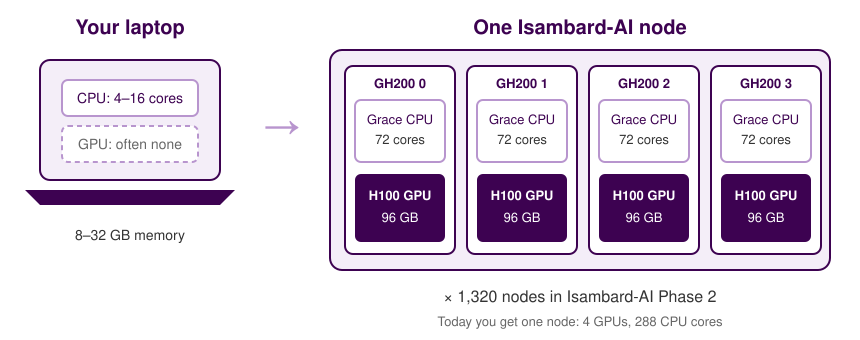
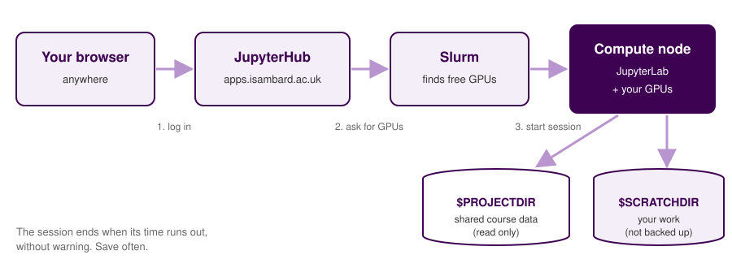
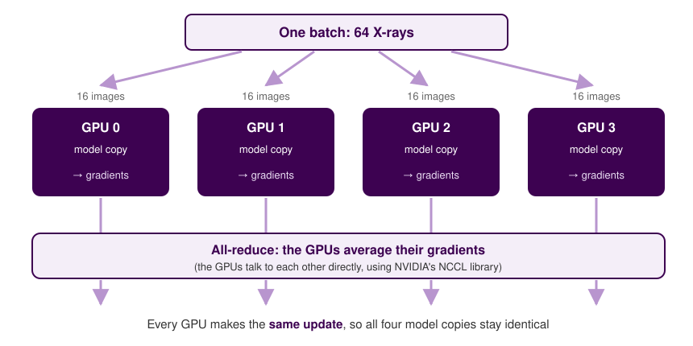

{width=220px fig-alt="University of Bristol logo"}

<!-- Course website hub: only rendered for the GitHub Pages build (render.py sets site: true) -->
::: {.content-visible when-meta="site"}
## About this page {.unnumbered .unlisted}

This page has everything you need for the course. The slides we use in the session are just below, followed by links to other material and then the full course notes, with all the exercises and answers. It's worth bookmarking so you can come back to it afterwards.

::: {.slides-embed}
```{=html}
<iframe id="slides-frame" src="slides.html" title="Course slides" allowfullscreen></iframe>
```
:::

::: {.hub-buttons}
```{=html}
<button type="button" class="btn hub-btn" onclick="document.getElementById('slides-frame').requestFullscreen()">⛶ Full screen</button>
<a class="btn hub-btn" href="slides.html" target="_blank" rel="noopener">Open slides in a new tab</a>
```
:::

Click on the slides, then use the arrow keys to move through them.

### Course materials {.unnumbered .unlisted}

::: {.cards .hub-cards}
::: {.card}
**[Instructor version](instructor.html)**<br>
These notes with the delivery team's guidance added: timings, cues and common problems.
:::

::: {.card}
**[Course notebook](https://github.com/Bristol-Training/hpc-for-ai-1/blob/main/notebooks/hpc-for-ai.ipynb)**<br>
The notebook you run during the session.
:::

::: {.card}
**[Introduction to AI](https://bristol-training.github.io/intro-to-ai/)**<br>
The course we recommend taking before this one.
:::

::: {.card}
**[Introduction to HPC](https://bristol-training.github.io/intro-hpc/)**<br>
Batch jobs and Slurm, which is a good next step after this course.
:::
:::
:::

# Introduction {.unnumbered}

In this course you'll use Isambard-AI, one of the UK's national supercomputers for AI research, to train a computer vision model.

Training a deep learning model means repeating the same calculations over and over, often millions of times. A laptop can manage this for small problems, but it soon gets too slow. Supercomputers like Isambard-AI are built around GPUs (graphics processing units), which can do thousands of these calculations at the same time. During the course you'll see how much difference a GPU makes, and what happens when you use more than one.

We'll use the same example throughout: training a model to spot bone fractures in X-ray images. A model like this could, with a lot more work, help clinicians decide which scans to look at first. This could be useful for patient triage in an emergency department.

## The data: FracAtlas {.unnumbered}

[FracAtlas](https://doi.org/10.6084/m9.figshare.22363012) is a public dataset of 4,083 X-ray images of hands, legs, hips and shoulders. The images were collected from three hospitals in Bangladesh and labelled by two radiologists, and 719 of them show at least one fracture. They have been anonymised and are shared under a [CC BY 4.0](https://creativecommons.org/licenses/by/4.0/) licence.

The images come with a file called `dataset.csv`, which has one row per image. These are the columns we'll use:

| Column | Description |
|---|---|
| `image_id` | File name of the image, e.g. `IMG0000019.jpg` |
| `fractured` | 1 if the image shows a fracture, 0 if not. This is what we want the model to predict. |
| `hand`, `leg`, `hip`, `shoulder` | 1 if the image shows that part of the body |
| `hardware` | 1 if the image shows surgical hardware, such as plates or screws |
| `multiscan` | 1 if the same body part was X-rayed from more than one angle |

::: {.big-statement}
4,083 X-rays and four GPUs. Can we teach a computer to spot a fracture?
:::

Each section of the course starts with a question, which you'll answer by running part of a notebook on Isambard-AI:

::: {.flow}
[Why HPC?]{.step} [→]{.arrow} [Isambard-AI]{.step} [→]{.arrow} [The data]{.step} [→]{.arrow} [1 GPU]{.step} [→]{.arrow} [4 GPUs]{.step} [→]{.arrow} [Good practice]{.step}
:::

### How to get the most out of this course {.unnumbered}

The notebook is already written, so you won't need to type much code. Instead, read each cell before you run it and make sure you know what it's doing. Once a cell has run, try changing something and running it again; the exercise at the end of each section gives you some ideas. Training the model takes a few minutes each time, so that's a good moment to ask questions.

### Intended learning outcomes {.unnumbered}

By the end of this course, you will:

- Understand when and why AI projects need high performance computing (HPC).
- Be able to start a JupyterHub session with GPUs on Isambard-AI.
- Be able to prepare an image dataset and train an image classification model on a GPU.
- Know how to judge a classifier on imbalanced medical data.
- Be able to train a model on several GPUs, and understand how this works.
- Know how to work considerately on a shared supercomputer.

### What this course doesn't cover {.unnumbered}

- Batch jobs and Slurm scripts, which are covered in [Introduction to HPC](https://bristol-training.github.io/intro-hpc/).
- Training across several nodes. For that, see the BriCS [Distributed PyTorch Training](https://docs.isambard.ac.uk/user-documentation/tutorials/distributed-training/) tutorial.
- How neural networks work. See [Introduction to AI](https://bristol-training.github.io/intro-to-ai/).

## How to read this document {.unnumbered}

Code from the course notebook is shown in a grey box with the notebook's name at the top. You'll find exactly the same code in one of the notebook's cells:

```{.python filename="hpc-for-ai.ipynb"}
baseline = (test_df["fractured"] == 0).mean()
print(f"Always guessing 'not fractured' would be {baseline:.1%} accurate")
```

Commands to type into a terminal look like this:

```{.bash filename="Terminal"}
nvidia-smi
```

There's an exercise at the end of each section, shown in a blue box. The answer is in the yellow box underneath; have a go yourself before you open it.

::: {#exampleN .callout-note icon=false title='Exercise'}
This is an exercise. Click on the box below to see the answer.
:::

::: {#answerN .callout-caution icon=false title='Answer (click to open)' collapse="true"}
This is the answer.
:::

Green boxes like this one sum up the main points of each section:

::: {#keypointsN .callout-tip icon=false title='Key points'}
These are the main points to take away.
:::

::: {.content-hidden when-meta="attendee"}
::: {.callout-important icon=false title='Instructor notes'}
Red boxes like this one are **instructor notes**. They are removed from the attendee copy of these notes (see `README.md`).

**How the session runs:** attendees run a complete notebook (`notebooks/hpc-for-ai.ipynb`) in JupyterHub on Isambard-AI. Introduce each section with the slides, then run the matching cells on your screen while attendees run them in their own session. The training cells take several minutes, so use that time to talk through what's happening, with the GPU dashboard and the diagrams.

**Suggested timings (3 hours):**

| Section | Topic | Approx. time |
|---|---|---|
| 1 | Why HPC for AI? | 0:00–0:20 |
| 2 | Getting onto Isambard-AI | 0:20–0:40 |
| 3 | Meet FracAtlas | 0:40–1:15 |
| | Break | 1:15–1:30 |
| 4 | Training on one GPU | 1:30–2:10 |
| 5 | Scaling to four GPUs | 2:10–2:45 |
| 6 | Good practice and next steps | 2:45–3:00 |

If you're running behind, start the 1-GPU training run just before the break so it finishes while people are away.

Before the course, work through the [instructor setup](#sec-instructor-setup) at the end of these notes.
:::
:::

## Before the course {.unnumbered}

You'll need:

- An Isambard-AI account that has been added to the course project. We'll email you an invitation before the course; accept it and follow the steps in the email.
- A UNIX username, set in the BriCS portal. JupyterHub won't start without one. There are instructions in [Setting your UNIX username](https://docs.isambard.ac.uk/user-documentation/guides/shortname/).
- A web browser. Everything happens in the browser, so you don't need to install anything.

Please check that you can log in to the [BriCS portal](https://portal.isambard.ac.uk) before the day.

# Why HPC for AI?

[Why can't I just use my laptop?]{.lead-question}

To train a neural network, we show it thousands of examples, many times over, and after each batch we adjust millions of numbers inside the model (its *weights*) by a small amount. Most of that work is multiplying large grids of numbers together.

::: {.cards}
::: {.card}
**CPU**
A CPU has a small number of fast, flexible cores. It's good at working through a series of different tasks.
:::
::: {.card}
**GPU**
A GPU has thousands of simpler cores that all do the same sum on different numbers at once, which is exactly what a neural network needs.
:::
:::

Most laptops have a CPU with a few cores, and many don't have an NVIDIA GPU, which is what most deep learning software is built to use. That's fine for learning and for small models, but bigger projects soon run into problems. Training can take hours or days, the model or a batch of images might not fit in memory, or you might want to try lots of different settings and not have time.

## Isambard-AI

Isambard-AI is a supercomputer in Bristol, run by the Bristol Centre for Supercomputing (BriCS) as part of the UK's AI Research Resource. Phase 2 of the system has 1,320 *nodes*, which are the individual computers that make up the supercomputer. Each node has four NVIDIA GH200 Grace Hopper "superchips", and each superchip combines a 72-core Grace CPU with an H100 GPU that has 96 GB of memory.

{fig-alt="A typical laptop has 4 to 16 CPU cores and often no GPU. One Isambard-AI node has four GH200 superchips, each with a 72-core Grace CPU and an H100 GPU with 96 GB of memory. Isambard-AI Phase 2 has 1,320 nodes."}

During the course you'll each have a whole node to yourself: four GPUs and 288 CPU cores.

::: {#keypoints1 .callout-tip icon=false title='Key points'}
- Training a neural network is mostly multiplying large matrices, which GPUs do very quickly.
- Each Isambard-AI node has four GH200 superchips, each with an H100 GPU.
- HPC is useful when training is too slow, needs more memory than you have, or has to be repeated many times.
:::

::: {.content-hidden when-meta="attendee"}
::: {.callout-important icon=false title='Instructor notes'}
**Slides only** for this section; nobody needs to be logged in yet.

**Ask the room:** has anyone trained a model that took more than an hour? What did they do while they waited? People's own experience makes the point better than the slides do.

**Keep it short.** The matrix multiplication demo in section 2 shows the CPU/GPU difference far better than a slide can.
:::
:::

::: {#exercise1 .callout-note icon=false title='Exercise'}
Think of a model you've trained, or would like to train, in your own work.

1. Roughly how long does one training run take on the computer you use now?
2. What limits you most: time, memory, or the number of runs you can do?
3. If a training run took 10 minutes, what would you do differently?
:::

::: {#answer1 .callout-caution icon=false title='Answer' collapse="true"}
There's no single right answer, but these are common replies:

- Time is the most common limit. If a run takes a day, you can only test one idea a day.
- Memory problems usually show up as "CUDA out of memory" errors, or as having to use smaller images or batches than you'd like.
- When runs are faster, most people say they'd try more ideas: other models, other settings and more data. This is often the biggest benefit of HPC.
:::

# Getting onto Isambard-AI

[How do I get a GPU?]{.lead-question}

On a supercomputer, you don't run your code on the computer you log in to. Instead, you ask a *scheduler* for the resources you need, and it finds a free compute node for you. The scheduler on Isambard-AI is called Slurm. JupyterHub talks to Slurm for us and then opens JupyterLab in the browser, running on the node Slurm found.

{fig-alt="Your browser connects to JupyterHub, which asks the Slurm scheduler for GPUs. Slurm starts JupyterLab on a compute node with four GH200s. The compute node reads shared course data from the project folder and saves your work to your scratch folder."}

## Start a session

1. Go to <https://apps.isambard.ac.uk/aip2-jupyter> and log in.
2. Fill in the Server Options form:

| Field | What to choose |
|---|---|
| Project | The course project (we'll tell you its name) |
| Job duration | The shortest option that lasts until the end of the course |
| Number of GH200s | 4 |
| Partition | Leave this empty |
| Reservation | `interactive` |

3. Click **Start**. You might see "Pending in queue" while Slurm finds you a node. This is usually quick, but it can take longer if the interactive nodes are busy.
4. JupyterLab opens in your browser once the node is ready.

::: {.callout-warning icon=false title='Your session has a time limit'}
When the time you chose runs out, the session ends straight away, with no warning. Save your notebook regularly (*Ctrl+S* or *Cmd+S*).
:::

## Set up the course kernel

The *kernel* is the Python environment your notebook runs in. We've made one for this course with PyTorch and all the other packages installed, and you need to tell JupyterLab about it. You only have to do this once.

In JupyterLab, open a terminal (*File → New → Terminal*) and run:

```{.bash filename="Terminal"}
$PROJECTDIR/hpc-ai-1/venv/bin/python -m ipykernel install --user --name hpc-ai-1 --display-name "Python (HPC for AI part 1)"
```

Then copy the course notebook into your home folder:

```{.bash filename="Terminal"}
cp $PROJECTDIR/hpc-ai-1/hpc-for-ai.ipynb ~/
```

Open `hpc-for-ai.ipynb` from the file browser on the left. The kernel name in the top right of the notebook should say "Python (HPC for AI part 1)". If it says something else, click on it and choose that kernel from the list.

::: {.content-hidden when-meta="attendee"}
::: {.callout-important icon=false title='Instructor notes'}
**Demo this on screen**, slowly. Most of the problems in this course happen here.

**Common problems:**

- *No UNIX username set*: the session won't start. Send them to the BriCS portal to set one; it can take a few minutes to work.
- *Not in the project*: the project won't appear in the drop-down list. Check they've accepted the invitation.
- *Someone has filled in Partition*: ask them to stop the server and start again with Partition empty. Setting a partition with the `interactive` reservation is against the acceptable use policy, and the job may be cancelled.
- *"Pending in queue" for a long time*: the interactive nodes are shared with everyone on Isambard-AI, and each person can only have one interactive job at a time. If someone already has another interactive job running (for example from an earlier session they didn't stop), their new session will wait until it finishes. Check with `squeue --me --partition=interactive`.
- *"Spawn failed: The Jupyter batch job has disappeared while pending in the queue"*: JupyterHub only waits so long for a node, then gives up, **but the Slurm job stays in the queue**. Ask them to cancel it before trying again, otherwise it blocks their next session and may start later with nobody using it: `squeue --me --partition=interactive` to find the job number, then `scancel <JOBID>`. In the dry run, this happened when asking for 4 GH200s, while 1 GH200 started within a minute or two.
- *A session just won't start*: pair them up with a neighbour.
- *Kernel not in the list*: refresh the browser tab after running the `ipykernel` command.
- *`$PROJECTDIR` is empty in the terminal*: use the full path, `/projects/b6er/hpc-ai-1/...`.
:::
:::

## Check your GPUs

Run the first two cells of the notebook. The first one loads the libraries we need:

```{.python filename="hpc-for-ai.ipynb"}
import os
import shutil
import time
from pathlib import Path

import matplotlib.pyplot as plt
import pandas as pd
import torch
from IPython.display import Image as ShowImage
from IPython.display import display
from PIL import Image
from sklearn.metrics import ConfusionMatrixDisplay, classification_report
from sklearn.model_selection import train_test_split

# Isambard-AI's compute nodes can't reach the internet, so tell Ultralytics
# not to try downloading anything. This must be set before importing it.
os.environ["YOLO_OFFLINE"] = "1"

# Lets training give the same result each time. It has to be set before the
# GPU is first used, which is why it's here at the top.
os.environ["CUBLAS_WORKSPACE_CONFIG"] = ":4096:8"
from ultralytics import YOLO
```

The cell also sets two *environment variables*, which are settings that libraries read when they start up:

- `YOLO_OFFLINE` tells Ultralytics not to try downloading anything (it normally checks for updates and downloads a font and some extra model files). Without it, you'd see warnings about failed downloads, and training would take a little longer to start.
- `CUBLAS_WORKSPACE_CONFIG` is needed for training to give exactly the same result each time it runs with the same settings. It has to be set before the GPU is first used, otherwise PyTorch prints a long warning during training.

The second asks PyTorch which GPUs it can see. It should find four, each with a name like `NVIDIA GH200`.

```{.python filename="hpc-for-ai.ipynb"}
print("PyTorch version:", torch.__version__)
print("CUDA available: ", torch.cuda.is_available())
print("Number of GPUs: ", torch.cuda.device_count())

for i in range(torch.cuda.device_count()):
    print(f"  GPU {i}: {torch.cuda.get_device_name(i)}")
```

You can also see the GPUs from the terminal with `nvidia-smi` (the NVIDIA System Management Interface), which lists each GPU, how much of its memory is in use and what's running on it:

```{.bash filename="Terminal"}
nvidia-smi
```

JupyterLab on Isambard-AI also has a GPU dashboard. Click the GPU icon in the left-hand sidebar, open the *GPU Utilization* and *GPU Memory* panels, and keep them somewhere you can see them. You'll use them to watch the GPUs while the model trains.

## Your first GPU job

To see how much faster a GPU is, the next cell multiplies two large matrices (8,192 × 8,192 numbers each), first on the CPU and then on a GPU, and times both.

```{.python filename="hpc-for-ai.ipynb"}
size = 8192
a = torch.randn(size, size)
b = torch.randn(size, size)

# On the CPU
start = time.perf_counter()
a @ b
cpu_time = time.perf_counter() - start

# On GPU 0
a_gpu = a.to("cuda")
b_gpu = b.to("cuda")
a_gpu @ b_gpu                # warm-up: the first call includes one-off set-up costs
torch.cuda.synchronize()

start = time.perf_counter()
a_gpu @ b_gpu
torch.cuda.synchronize()     # wait for the GPU to finish before stopping the clock
gpu_time = time.perf_counter() - start

print(f"CPU: {cpu_time:.3f} s")
print(f"GPU: {gpu_time:.4f} s")
print(f"The GPU was {cpu_time / gpu_time:.0f}x faster")
```

A couple of lines need explaining:

- `.to("cuda")` copies the numbers from the CPU's memory into the GPU's memory. CUDA is NVIDIA's platform for running code on its GPUs.
- `torch.cuda.synchronize()` waits for the GPU to finish. Python doesn't wait for the GPU by default; it carries on as soon as it has *sent* the work. Without this line we'd be timing how long it took to send the work, rather than how long it took to do it.

We also run the multiplication once on the GPU before we start timing. The first thing you do on a GPU is slower than usual because of one-off setup, and we don't want that in our timing.

## Where things live

Isambard-AI has several places to store files. We'll use three of them:

| Location | What it is | What we use it for |
|---|---|---|
| `$PROJECTDIR` | Shared by everyone in the project. Not backed up. | The dataset, model weights and course kernel. You can read these but not change them. |
| `$SCRATCHDIR` | Your own working space. Not backed up. | Everything you create, including the data split and your trained models. |
| `$HOME` | Your home folder, limited to 100 GiB. Not backed up. | Your copy of the notebook. |

The compute nodes on Isambard-AI can't connect to the internet, so everything the notebook needs, including the dataset and the model weights, has been downloaded in advance into the project folder. The next cell sets up the paths to these files, and to your own working folder. It should print `True` for both the dataset and the model weights.

```{.python filename="hpc-for-ai.ipynb"}
# Shared course files (read-only for you)
COURSE_DIR = Path(os.environ.get("PROJECTDIR", "/projects/b6er")) / "hpc-ai-1"
DATA_DIR = COURSE_DIR / "FracAtlas"
WEIGHTS = COURSE_DIR / "weights" / "yolov8n-cls.pt"

# Your own working folder
WORK_DIR = Path(os.environ.get("SCRATCHDIR", Path.home())) / "hpc-ai-1"
SPLIT_DIR = WORK_DIR / "fracatlas-split"
RUNS_DIR = WORK_DIR / "runs"
WORK_DIR.mkdir(parents=True, exist_ok=True)

print("Dataset found:     ", DATA_DIR.exists(), "-", DATA_DIR)
print("Model weights found:", WEIGHTS.exists(), "-", WEIGHTS)
print("Your work folder:  ", WORK_DIR)
```

::: {#keypoints2 .callout-tip icon=false title='Key points'}
- JupyterHub asks the Slurm scheduler for GPUs and opens JupyterLab on a compute node.
- Your session ends with no warning when its time runs out, so save regularly.
- You can see what the GPUs are doing with `nvidia-smi` or the GPU dashboard.
- Shared data goes in `$PROJECTDIR` and your own working files go in `$SCRATCHDIR`. Neither is backed up.
:::

::: {#exercise2 .callout-note icon=false title='Exercise'}
1. Run `nvidia-smi` in a terminal. How much memory does each GPU have, and how much is being used?
2. Change `size` to `16384` in the matrix multiplication cell and run it again. Each matrix now has four times as many numbers. How do the CPU and GPU times change?
:::

::: {#answer2 .callout-caution icon=false title='Answer' collapse="true"}
1. Each GPU has about 96 GB of memory (`nvidia-smi` shows it in MiB). Once you've run the matrix multiplication cell, GPU 0 shows some memory in use by your notebook; the other three are almost empty.
2. Multiplying two *n* × *n* matrices takes roughly *n*³ operations, so doubling `size` means about 8 times as much work. The CPU time goes up a lot. The GPU time goes up much less, because the GPU has more work to spread across its cores, so the gap between the two usually gets bigger. Your exact numbers will be different.
:::

# Meet FracAtlas

[What does our data look like?]{.lead-question}

Before training a model, it's worth spending some time getting to know the data. In this section we'll load the labels, look at some of the images and split the data into training, validation and test sets. None of this needs a GPU.

## Load the labels

```{.python filename="hpc-for-ai.ipynb"}
df = pd.read_csv(DATA_DIR / "dataset.csv")

print(df.shape)
df.head()
```

There's one row for each image, and `df.shape` shows that there are 4,083 rows.

## How balanced are the classes?

```{.python filename="hpc-for-ai.ipynb"}
counts = df["fractured"].value_counts().rename({0: "Not fractured", 1: "Fractured"})
print(counts)
print(f"\n{df['fractured'].mean():.1%} of images show a fracture")

counts.plot(kind="bar", color=["#b895ce", "#3d0251"], rot=0, title="FracAtlas: images per class")
plt.ylabel("Number of images")
plt.show()
```

Only about 1 in 6 of the images shows a fracture. Data like this is called *imbalanced*, and we have to be careful about how we judge a model trained on it, which we'll come back to in section 4.

## Find the image files

The images are in two folders, `images/Fractured` and `images/Non_fractured`. This function works out where each image is from its row in the table, and we add the result as a new column.

```{.python filename="hpc-for-ai.ipynb"}
def image_path(row):
    folder = "Fractured" if row["fractured"] == 1 else "Non_fractured"
    return DATA_DIR / "images" / folder / row["image_id"]


df["path"] = df.apply(image_path, axis=1)

print("All image files found:", df["path"].map(Path.exists).all())
```

## Look at some examples

```{.python filename="hpc-for-ai.ipynb"}
fig, axes = plt.subplots(2, 4, figsize=(14, 7))

for row_axes, label, title in zip(axes, [1, 0], ["Fractured", "Not fractured"]):
    sample = df[df["fractured"] == label].sample(4, random_state=1)
    for ax, (_, row) in zip(row_axes, sample.iterrows()):
        ax.imshow(Image.open(row["path"]), cmap="gray")
        ax.set_title(f"{title}\n{row['image_id']}", fontsize=9)
        ax.axis("off")

plt.tight_layout()
plt.show()
```

Some of the fractures are easy to see. Others are hard to find even when you know they're there.

::: {.callout-note icon=false title='A note about this copy of the data'}
87 of the non-fractured images in the FracAtlas download are slightly damaged: the end of each file is missing. When these images are opened, some of them show the missing part as a flat grey band along the bottom. Because only non-fractured images have the band, a model could learn that "grey band means not fractured", which has nothing to do with bones. We've cropped the grey bands off and repaired the files in the copy we're using, and listed the changes in `FracAtlas/truncated-images.txt`. Problems like this are common in real datasets, so it's always worth checking your images before training on them.
:::

## How big are the images?

```{.python filename="hpc-for-ai.ipynb"}
sizes = [Image.open(p).size for p in df["path"].sample(200, random_state=1)]
sizes = pd.DataFrame(sizes, columns=["width", "height"])
sizes.describe().round()
```

Look at the widths and heights in the table. The model needs every image to be the same size, so when it loads an image it scales it until the shorter side is 512 pixels, then keeps the middle 512 × 512 square. For a tall image, that means a little is cut off the top and bottom. Choosing the size is a trade-off. Smaller images train faster, but fine details such as hairline fractures can get lost. In our dry run, 224 × 224 pixels with only 10 epochs trained in 30 seconds, but the model found far fewer of the fractures than 512 × 512 pixels with 50 epochs.

## Fractures by body region

```{.python filename="hpc-for-ai.ipynb"}
regions = ["hand", "leg", "hip", "shoulder"]

region_stats = pd.DataFrame(
    {
        "images": [df[r].sum() for r in regions],
        "fractured": [df.loc[df[r] == 1, "fractured"].sum() for r in regions],
    },
    index=regions,
)
region_stats["% fractured"] = (100 * region_stats["fractured"] / region_stats["images"]).round(1)
region_stats
```

## Split the data

We split the images into three sets:

::: {.flow}
[Training 70%]{.step} [Validation 15%]{.step .light} [Test 15%]{.step .light}
:::

- The model learns from the **training** set.
- After each epoch, we check how the model is doing on the **validation** set.
- We keep the **test** set aside until the very end, to see how well the model does on images it has never seen.

`stratify=df["fractured"]` keeps the same proportion of fractured images in each set, and `random_state=42` means we get the same split every time we run the cell.

```{.python filename="hpc-for-ai.ipynb"}
train_df, temp_df = train_test_split(
    df, test_size=0.3, stratify=df["fractured"], random_state=42
)
val_df, test_df = train_test_split(
    temp_df, test_size=0.5, stratify=temp_df["fractured"], random_state=42
)

for name, part in [("train", train_df), ("val", val_df), ("test", test_df)]:
    print(f"{name:5}: {len(part):4} images, {part['fractured'].mean():.1%} fractured")
```

::: {.callout-warning icon=false title='Can images of the same patient end up in different sets?'}
With medical images, all the images of one patient should go in the same set. If they don't, the model can learn to recognise the patient instead of the fracture, and it will look better on the test set than it really is. This is called *data leakage*.

FracAtlas doesn't include patient IDs (they were removed to protect patients' privacy), so we can't do that here. We know from the `multiscan` column that some body parts were X-rayed from more than one angle, so some of our test images probably have a matching image in the training set. Bear this in mind when you look at the results, and split by patient whenever your own data lets you.
:::

## Arrange the images for the model

The Ultralytics library, which we'll use to train the model, expects the images to be in one folder per set, with a subfolder for each class:

```
fracatlas-split/
├── train/
│   ├── fractured/
│   └── not_fractured/
├── val/
│   ├── fractured/
│   └── not_fractured/
└── test/
    ├── fractured/
    └── not_fractured/
```

Copying all 4,083 images for everyone on the course would take a while and waste space. Instead, we make *symbolic links* (symlinks), which are tiny files that point to the original images in the shared folder. The model reads them as if they were the images themselves.

```{.python filename="hpc-for-ai.ipynb"}
CLASS_NAMES = {1: "fractured", 0: "not_fractured"}

if SPLIT_DIR.exists():
    shutil.rmtree(SPLIT_DIR)  # start fresh if you re-run this cell (removes the links, not the images)

for split, part in [("train", train_df), ("val", val_df), ("test", test_df)]:
    for _, row in part.iterrows():
        link = SPLIT_DIR / split / CLASS_NAMES[row["fractured"]] / row["image_id"]
        link.parent.mkdir(parents=True, exist_ok=True)
        link.symlink_to(row["path"])

for split in ["train", "val", "test"]:
    for class_dir in sorted((SPLIT_DIR / split).iterdir()):
        print(f"{split}/{class_dir.name}: {len(list(class_dir.iterdir()))} images")
```

::: {#keypoints3 .callout-tip icon=false title='Key points'}
- FracAtlas has 4,083 X-rays, and about 1 in 6 shows a fracture, so the classes are imbalanced.
- We split the data 70/15/15 into training, validation and test sets, with the same proportion of fractures in each.
- With medical data, split by patient to avoid leakage. FracAtlas has no patient IDs, so our results may be a little too good.
- Symbolic links let us arrange shared data without copying it.
:::

::: {.content-hidden when-meta="attendee"}
::: {.callout-important icon=false title='Instructor notes'}
**Pace:** this section has the most cells. Run them on screen, but spend your time on why we're doing each step. Attendees need the class imbalance and the leakage box for section 4.

**Question to ask about leakage:** "If the same wrist was X-rayed from the front and the side, and one image is in the training set and the other is in the test set, what could go wrong?"

**Common problems:**

- *`FileNotFoundError` for `dataset.csv`*: the path cell printed `False`. Check they're in the `b6er` project (`echo $PROJECTDIR` in a terminal should print `/projects/b6er`).
- *Running the symlink cell twice*: this is fine. `shutil.rmtree` only removes the links, not the original images.
:::
:::

::: {#exercise3 .callout-note icon=false title='Exercise'}
Add a new cell to the notebook to answer these questions:

1. How many images show surgical hardware (the `hardware` column)?
2. What percentage of those images show a fracture?
3. Why might hardware cause problems for a fracture classifier?
:::

::: {#answer3 .callout-caution icon=false title='Answer' collapse="true"}
```{.python}
with_hardware = df[df["hardware"] == 1]
print(len(with_hardware), "images show hardware")
print(f"{with_hardware['fractured'].mean():.1%} of them are fractured")
```

Run the cell to see how many images have hardware, and how many of those are fractured.

Hardware could give the model a *shortcut*. Plates and screws are bright and easy to spot, and they're put in after a fracture, so a model might learn that "hardware means fracture" instead of learning what a fracture looks like. Looking for shortcuts like this is an important part of checking whether a medical AI model can be trusted.
:::

# Training on one GPU

[Can a computer learn to spot a fracture?]{.lead-question}

## The model

We'll use YOLOv8n-cls, a small image classification model from the [Ultralytics](https://docs.ultralytics.com/tasks/classify/) library. It's a *convolutional neural network*, a type of neural network that picks out patterns such as edges, textures and shapes in different parts of an image.

To train a model like this from scratch, we'd need far more than 4,000 images. Instead we use *transfer learning*. We start with a model that has already been trained on more than a million everyday photos (the ImageNet dataset), so it has already learned to recognise general visual patterns, and then we *fine-tune* it on our X-rays.

## Training settings

```{.python filename="hpc-for-ai.ipynb"}
EPOCHS = 50
IMG_SIZE = 512
BATCH = 64
WORKERS = 8
```

| Setting | What it means |
|---|---|
| `EPOCHS` | The number of times the model sees every training image. |
| `IMG_SIZE` | The width and height, in pixels, of the square each image is turned into. |
| `BATCH` | The number of images the model looks at before it updates its weights. |
| `WORKERS` | The number of CPU processes loading images in the background, so the GPU doesn't have to wait for them. |

## Train

Open the GPU dashboard before you run the next cell so that you can watch the GPU while the model trains.

```{.python filename="hpc-for-ai.ipynb"}
model = YOLO(WEIGHTS)

start = time.perf_counter()
model.train(
    data=str(SPLIT_DIR),
    epochs=EPOCHS,
    imgsz=IMG_SIZE,
    batch=BATCH,
    workers=WORKERS,
    device=0,             # one GPU
    project=str(RUNS_DIR),
    name="1gpu",
    exist_ok=True,
    seed=42,
)
time_1gpu = time.perf_counter() - start

print(f"Training on 1 GPU took {time_1gpu / 60:.1f} minutes")
```

`device=0` tells Ultralytics to use GPU 0 only. `project` and `name` tell it where to save the results, which in this case is `runs/1gpu` in your scratch folder.

While it's training, Ultralytics prints a line for each epoch with the *loss*, which measures how wrong the model is on the training images, and the accuracy on the validation set. The loss should go down and the accuracy should go up.

## How did training go?

Ultralytics saves some plots of the training run in the run's folder. This cell shows two of them. In the first, ignore the `accuracy_top5` plot: it measures whether the right answer is in the model's top five guesses, and with only two classes it always is.

```{.python filename="hpc-for-ai.ipynb"}
run_1gpu = RUNS_DIR / "1gpu"

for plot in ["results.png", "confusion_matrix_normalized.png"]:
    if (run_1gpu / plot).exists():
        display(ShowImage(filename=str(run_1gpu / plot), width=800))
```

## Test the model

The version of the model that did best on the validation set is saved as `best.pt`. We load it, ask it to classify every image in the test set, and compare its answers with the real labels. `"*"` in the path means "anything", so `test/*/*.jpg` matches every image in both class folders. The folder each image is in tells us its real label.

```{.python filename="hpc-for-ai.ipynb"}
def evaluate(weights):
    """Classify every test image and return the true and predicted labels."""
    model = YOLO(weights)
    true, pred = [], []
    test_images = str(SPLIT_DIR / "test" / "*" / "*.jpg")  # every image in every class folder
    for result in model.predict(test_images, imgsz=IMG_SIZE, stream=True, verbose=False):
        true.append(Path(result.path).parent.name)  # the folder name is the true label
        pred.append(result.names[result.probs.top1])  # the class the model thinks is most likely
    return true, pred


true, pred = evaluate(run_1gpu / "weights" / "best.pt")

print(classification_report(true, pred, digits=3))
ConfusionMatrixDisplay.from_predictions(true, pred, cmap="Purples")
plt.title("1 GPU: test set")
plt.show()
```

`classification_report` gives three scores for each class:

| Score | What it tells us about the `fractured` class |
|---|---|
| Precision | When the model says "fractured", how often is it right? |
| Recall | What proportion of the real fractures did the model find? This is also called *sensitivity*. |
| F1-score | A single score that combines precision and recall. |

## Is that accuracy any good?

```{.python filename="hpc-for-ai.ipynb"}
baseline = (test_df["fractured"] == 0).mean()
print(f"Always guessing 'not fractured' would be {baseline:.1%} accurate")
```

Most of the images don't show a fracture, so a "model" that always said "not fractured" would be right over 80% of the time, and it wouldn't find a single fracture. That's why accuracy on its own can be misleading when the data is imbalanced. If we wanted to use this model to decide which scans to look at first, the most important score would be the recall for the fractured class. Missing a fracture is worse than a false alarm that a clinician can check and rule out.

::: {#keypoints4 .callout-tip icon=false title='Key points'}
- Transfer learning starts with a model trained on everyday photos and fine-tunes it on our X-rays.
- `device=0` trains on a single GPU, and the GPU dashboard shows it working.
- Always compare accuracy with a simple baseline. With imbalanced data, look at the recall (sensitivity) for the class you care about most.
:::

::: {.content-hidden when-meta="attendee"}
::: {.callout-important icon=false title='Instructor notes'}
**While it's training** (several minutes), show the GPU dashboard and point out that only GPU 0 is working. Ask whether it's at 100%, and if not, what it might be waiting for. (Often it's the CPU workers loading images.) This leads into section 5.

**Dry-run numbers** (1 GH200, `EPOCHS = 50`, `IMG_SIZE = 512`), so you can tell people what to expect: training took **3.4 minutes**, test accuracy was **92.5%**, and fractured recall was **0.67** (72 of 108 fractures found), with precision 0.88. Expect some variation between runs: with only 108 fractures in the test set, each one missed or found changes recall by about 0.01.

With `IMG_SIZE = 224` and 10 epochs, training took 30 seconds but recall was only 0.44. That's a good comparison to mention if anyone asks why we use bigger images.

**Common problems:**

- *Slow to start the first time*: Ultralytics checks and caches the dataset before training.
- *Download warnings*: the notebook sets `YOLO_OFFLINE=1`, but Ultralytics may still mention that it skipped its AMP check or couldn't find a font. These are harmless. If anyone sees errors about downloading model weights, check the path cell printed `True` for the weights.
- *Running out of time*: reduce `EPOCHS` and run the settings cell again.
:::
:::

::: {#exercise4 .callout-note icon=false title='Exercise'}
Look at the classification report and confusion matrix for your 1-GPU model.

1. What is the model's recall for the `fractured` class? What does that number mean in plain English?
2. How many of the real fractures in the test set did the model miss?
3. Would you be happy using this model to decide which X-rays to look at first? What would you want to know before you did?
4. *If you have time:* change `IMG_SIZE` to `224` in the settings cell, then run the training and testing cells again. How do the training time and recall change?
:::

::: {#answer4 .callout-caution icon=false title='Answer' collapse="true"}
1. Look at the `recall` value in the `fractured` row. A recall of 0.70, for example, means the model found 70% of the fractures in the test set and missed the other 30%.
2. In the confusion matrix, the missed fractures are the images where the true label is `fractured` but the predicted label is `not_fractured`.
3. Almost certainly not yet. You'd want to know, for example, how well it works on X-rays from other hospitals and for each body region, whether it's taking shortcuts such as spotting hardware, how it does with a proper split by patient, and whether it actually helps in a clinical study. A model like this would only ever support a clinician's decision, not replace it.
4. Training should be quite a bit faster with smaller images. Recall may drop, because fine details such as hairline fractures can be lost when the image is made smaller, but with only 108 fractures in the test set, a small difference could just be chance. Remember to set `IMG_SIZE` back to `512` afterwards.
:::

# Scaling to four GPUs

[Is more GPUs always faster?]{.lead-question}

## Data parallelism

So far, only one of our four GPUs has done any work. The simplest way to use all four is called *data parallelism*.

{fig-alt="A batch of 64 images is split into four slices of 16. Each GPU holds an identical copy of the model, processes its slice and works out its own gradients. The GPUs then average their gradients in an all-reduce step, so every copy makes the same update and stays identical."}

1. Each GPU gets its own copy of the model.
2. Each batch is shared out between the GPUs. With a batch of 64 and four GPUs, each GPU gets 16 images.
3. Each GPU works out how the model should change, using its own 16 images. These changes are called *gradients*.
4. The GPUs average their gradients. They do this by sending data directly to each other, using an NVIDIA library called NCCL, in a step called an *all-reduce*.
5. Each GPU updates its copy of the model with the averaged gradients, so all four copies stay the same.

## What's happening behind the scenes

PyTorch does this using *Distributed Data Parallel* (DDP). DDP runs a separate Python process for each GPU, and gives each process a number from 0 to 3, called its *rank*.

Your notebook is only one Python process, so Ultralytics gets round this by writing a short training script and running four copies of it, one per GPU, with PyTorch's `torch.distributed.run` command. Look for a line starting with `DDP:` in the output, which shows the exact command it used. If you run `nvidia-smi` in a terminal while it's training, you'll see four Python processes, one on each GPU.

## Train on four GPUs

The only thing we change is `device=[0, 1, 2, 3]`.

```{.python filename="hpc-for-ai.ipynb"}
model = YOLO(WEIGHTS)

start = time.perf_counter()
model.train(
    data=str(SPLIT_DIR),
    epochs=EPOCHS,
    imgsz=IMG_SIZE,
    batch=BATCH,          # the total batch is shared out: 64 / 4 = 16 images per GPU
    workers=WORKERS,
    device=[0, 1, 2, 3],  # four GPUs
    project=str(RUNS_DIR),
    name="4gpu",
    exist_ok=True,
    seed=42,
)
time_4gpu = time.perf_counter() - start

print(f"Training on 4 GPUs took {time_4gpu / 60:.1f} minutes")
```

## Was it faster?

```{.python filename="hpc-for-ai.ipynb"}
timings = pd.DataFrame(
    {"minutes": [time_1gpu / 60, time_4gpu / 60]},
    index=["1 GPU", "4 GPUs"],
)
timings["speed-up"] = (time_1gpu / 60 / timings["minutes"]).round(2)
print(timings.round(2))

timings["minutes"].plot(kind="barh", color=["#b895ce", "#3d0251"], title="Training time")
plt.xlabel("Minutes")
plt.show()
```

It almost certainly wasn't four times faster. There are a few reasons for this:

- It takes time to start four processes and connect the GPUs to each other, and for a short training run that's a large part of the total time.
- After every batch, the GPUs have to stop and share their gradients.
- Each GPU only gets 16 images per batch now, so it has less work to do between each round of sharing gradients, and spends more of its time waiting.
- The CPU workers now have to load images for four GPUs instead of one.

With a small model and dataset like ours, these costs can cancel out most of the benefit of the extra GPUs. With large models and datasets that take hours or days to train, they matter much less, and more GPUs can make a big difference.

## Is the model just as good?

```{.python filename="hpc-for-ai.ipynb"}
true, pred = evaluate(RUNS_DIR / "4gpu" / "weights" / "best.pt")

print(classification_report(true, pred, digits=3))
ConfusionMatrixDisplay.from_predictions(true, pred, cmap="Purples")
plt.title("4 GPUs: test set")
plt.show()
```

The results should be close to the 1-GPU model's, but not exactly the same. The images are shuffled differently and each batch is shared out between the GPUs, so the training doesn't follow exactly the same path.

## Give each GPU more work

To make the comparison fairer, we can give each GPU as much work as the single GPU had before. That means 64 images per GPU, or a total batch of 256.

```{.python filename="hpc-for-ai.ipynb"}
model = YOLO(WEIGHTS)

start = time.perf_counter()
model.train(
    data=str(SPLIT_DIR),
    epochs=EPOCHS,
    imgsz=IMG_SIZE,
    batch=BATCH * 4,      # 256 / 4 = 64 images per GPU
    workers=WORKERS,
    device=[0, 1, 2, 3],
    project=str(RUNS_DIR),
    name="4gpu-bigbatch",
    exist_ok=True,
    seed=42,
)
time_4gpu_big = time.perf_counter() - start

timings.loc["4 GPUs, 4x batch", "minutes"] = time_4gpu_big / 60
timings["speed-up"] = (time_1gpu / 60 / timings["minutes"]).round(2)
print(timings.round(2))
```

::: {.callout-note icon=false title='Bigger batches change how the model trains'}
With a batch of 256, the model only updates its weights once for every 256 images, instead of once for every 64. That can change how well it learns, and people often increase the learning rate to make up for it. A faster model is only useful if it's still a good model, so check the test results as well as the time.
:::

::: {#keypoints5 .callout-tip icon=false title='Key points'}
- In data parallel training, each GPU has a copy of the model and part of each batch, and the GPUs average their gradients after every batch.
- PyTorch's DDP runs one process per GPU. Ultralytics starts these processes for you when you give it a list of GPUs.
- Using more GPUs adds extra work: starting up, sharing gradients and loading data. Small jobs might hardly speed up at all.
- To keep each GPU busy, increase the total batch size along with the number of GPUs, and check that the model is still as accurate.
:::

::: {.content-hidden when-meta="attendee"}
::: {.callout-important icon=false title='Instructor notes'}
**While it's training**, show the dashboard with all four GPUs working, and `nvidia-smi` in a terminal with four processes. Point out the `DDP:` line in the output.

**Your dry-run numbers:** TODO 4-GPU time, 4-GPU big-batch time.

**Don't apologise if it isn't much faster.** With a model this small, the 4-GPU run might be only slightly faster, or even slower. That's the answer to this section's question.

**Common problems:**

- *No training output in the notebook*: the training runs in separate processes, and on some setups their output goes to the server log instead of the notebook. TODO: check in the dry run. If this happens, tell people to watch the dashboard and wait for the cell to finish.
- *`Address already in use`, or the cell never finishes*: a previous DDP run didn't shut down properly. Restart the kernel (*Kernel → Restart Kernel*), run the setup cells again and try again.
- *Running out of time*: skip the bigger batch run. It's an extra.
:::
:::

::: {#exercise5 .callout-note icon=false title='Exercise'}
Fill in this table with your own results:

| Run | Minutes | Speed-up | Fractured recall |
|---|---|---|---|
| 1 GPU, batch 64 | | 1.0 | |
| 4 GPUs, batch 64 | | | |
| 4 GPUs, batch 256 | | | |

1. Which run was fastest? Was the speed-up close to 4?
2. Did the model get better, get worse or stay about the same?
3. What do you think would happen with a much bigger model, such as `yolov8x-cls.pt`?
:::

::: {#answer5 .callout-caution icon=false title='Answer' collapse="true"}
Your numbers will be different, but this is what usually happens:

1. Four GPUs with a batch of 256 should usually be faster than four GPUs with a batch of 64, because each GPU does more work between each round of sharing gradients. Neither is close to four times faster for a job this small, because starting up, sharing gradients and loading data take up a lot of the time.
2. Usually about the same. The bigger batch might be slightly worse, because the model updated its weights fewer times.
3. A bigger model does much more calculation for each image, so the GPUs spend more of their time calculating and less time waiting. The speed-up from four GPUs gets closer to four. (You'd need to download the bigger model's weights first.)
:::

# Good practice and next steps

[How do I use a shared supercomputer well?]{.lead-question}

Isambard-AI is used by researchers all over the UK. These habits help it work well for everyone, including you.

## Look after your session

Check how much time your session has left by running this in a terminal:

```{.bash filename="Terminal"}
squeue --me --partition=interactive --name="spawner-jupyterhub" --format="%.10M %.10L"
```

`TIME` is how long your session has been running and `TIME_LEFT` is how long it has left. You need `--partition=interactive` because sessions in the interactive reservation don't show up in `squeue --me` on its own. Remember that the session ends without any warning, so save your work regularly.

When you've finished, stop your server by going to *File → Hub Control Panel* and clicking **Stop My Server**. Until you do, the GPUs stay reserved for you even if you aren't using them, and they count against your project's allocation.

## Look after your data

None of the storage on Isambard-AI is backed up, including `$HOME`, `$SCRATCHDIR` and `$PROJECTDIR`, so copy anything important somewhere safe.

Put large datasets in `$PROJECTDIR`, so everyone in the project can share one copy, as we did with FracAtlas. Keep working files, such as checkpoints and outputs, in `$SCRATCHDIR` rather than `$HOME`, which is limited to 100 GiB.

## Use the GPUs well

- Keep an eye on the GPU dashboard. If a GPU is idle a lot of the time, adding more GPUs won't help. Try more data-loading workers, a bigger batch or a bigger model instead.
- Start small. Test your code on one GPU for a few epochs before you ask for more.
- Only ask for what you need. If your job only uses one GPU, ask for one GH200 rather than four.

## When to move on from notebooks

Notebooks are good for exploring data and learning, but they're not ideal for long training runs. The session has a time limit, and if your browser or internet connection drops, you can lose track of where you were.

For real projects, the next step is to put your training code into a Python script and submit it to Slurm as a *batch job*. A batch job runs on its own, even after you've logged out, and you can queue up lots of runs at once. Our [Introduction to HPC](https://bristol-training.github.io/intro-hpc/) course covers how to do this.

::: {#keypoints6 .callout-tip icon=false title='Key points'}
- Save regularly, check how much time you have left with `squeue`, and stop your server when you've finished.
- None of the storage on Isambard-AI is backed up. Share large datasets in `$PROJECTDIR` and keep working files in `$SCRATCHDIR`.
- Use the GPU dashboard to check your GPUs are busy before asking for more of them.
- For long training runs, move from notebooks to scripts and batch jobs.
:::

::: {.content-hidden when-meta="attendee"}
::: {.callout-important icon=false title='Instructor notes'}
**Finish on time**, and make sure everyone has stopped their server before they leave. Interactive sessions are charged at a premium, and a forgotten session keeps its GPUs reserved until it times out. Before people go, ask them to run the `squeue` command from this section and check it shows nothing.

Share the feedback form: TODO add link.
:::
:::

::: {#exercise6 .callout-note icon=false title='Exercise'}
1. Run the `squeue` command above in a terminal. How long does your session have left?
2. Run `du -sh $SCRATCHDIR/hpc-ai-1` to see how much space your work takes up. Why is it so small when there are 4,083 images?
3. Stop your server.
:::

::: {#answer6 .callout-caution icon=false title='Answer' collapse="true"}
1. The `TIME_LEFT` column shows the time remaining, in hours, minutes and seconds.
2. Your split folder only contains symbolic links, not copies of the images, so it takes up almost no space. Most of the space is taken up by the trained models in `runs/`.
3. Go to *File → Hub Control Panel* and click **Stop My Server**.
:::

## Where to go next

- [Introduction to HPC](https://bristol-training.github.io/intro-hpc/) covers scripts, batch jobs and Slurm.
- The [Isambard-AI documentation](https://docs.isambard.ac.uk/), including the [JupyterHub guide](https://docs.isambard.ac.uk/user-documentation/guides/jupyterhub/).
- The BriCS [Distributed PyTorch Training](https://docs.isambard.ac.uk/user-documentation/tutorials/distributed-training/) tutorial shows how to train across several nodes.
- The [Ultralytics image classification documentation](https://docs.ultralytics.com/tasks/classify/).
- [Applying for access to Isambard-AI](https://docs.isambard.ac.uk/access/) for your own project.

## Credits and citation {.unnumbered}

This course uses the FracAtlas dataset. If you use it in your own work, please cite:

> Abedeen, I., Rahman, M. A., Prottyasha, F. Z., Ahmed, T., Chowdhury, T. M. & Shatabda, S. (2023). FracAtlas: A Dataset for Fracture Classification, Localization and Segmentation of Musculoskeletal Radiographs. *Scientific Data*, 10, 521. <https://doi.org/10.1038/s41597-023-02432-4>

The dataset is available from [figshare](https://doi.org/10.6084/m9.figshare.22363012) under a CC BY 4.0 licence.

This course is based on Evie Grace's [Radiograph-Reader](https://github.com/evie-grace/Radiograph-Reader) project. Developed by the [Jean Golding Institute](https://www.bristol.ac.uk/golding/). Jean Golding Institute © CC BY 4.0.

::: {.content-hidden when-meta="attendee"}
# Instructor setup {#sec-instructor-setup .unnumbered}

::: {.callout-important icon=false title='Instructor notes'}
Everything in this section needs doing **before the course**. Allow at least a few weeks for getting access.

**1. The training project and interactive nodes**

The course runs in the training project, using the `interactive` reservation. This is a small pool of nodes kept free for short interactive work like this. Its limits, from the [job scheduling docs](https://docs.isambard.ac.uk/user-documentation/information/job-scheduling/), are:

| Limit | Value |
|---|---|
| Running jobs per person | 1 |
| Largest job | 4 nodes |
| Longest job | 8 hours |
| Cost | 50% more than normal (1 node-hour is charged as 1.5) |

Things to check before the course:

- **How many attendees can have 4 GPUs at once.** Some projects are limited to 32 GPUs in total, which would mean only 8 people with a whole node each. Ask BriCS whether the training project has a GPU limit. If it does, either limit numbers, or put attendees in pairs sharing one session.
- **Whether the project's allocation covers it.** Each attendee uses one node for about 3 hours, which is about 4.5 node-hours each with the interactive premium. Don't forget the instructors and the dry run.
- **Queueing.** There's no reservation, so attendees share the interactive nodes with everyone else on Isambard-AI. In the dry run, a 1-GH200 session started within a minute or two, but a 4-GH200 request waited until JupyterHub gave up. Ask people to start their session as soon as they arrive, and have a plan ready if 4-GH200 sessions don't start (pairs, or 1 GH200 each with section 5 demonstrated on your screen).
- **Accounts.** Send project invitations at least a week before, and remind people to set a UNIX username.

**2. Shared files**

The compute nodes can't reach the internet, so a JupyterHub terminal can't download anything. Do all of this over SSH on a **login node** instead (see [Log in (SSH and Clifton)](https://docs.isambard.ac.uk/user-documentation/guides/login/)). It sets up this folder structure in the training project's folder. The folder is called `hpc-ai-1` so that Part 2 of the course can have its own `hpc-ai-2` folder alongside it.

```
$PROJECTDIR/hpc-ai-1/
├── venv/                  the course Python environment (kernel)
├── FracAtlas/             the dataset, unzipped from figshare
├── weights/yolov8n-cls.pt the model weights, downloaded in advance
└── hpc-for-ai.ipynb       the course notebook
```

```{.bash filename="Terminal (login node)"}
# Get the course materials (into your own scratch space, not the shared folder)
cd $SCRATCHDIR
git clone https://github.com/Bristol-Training/hpc-for-ai-1.git

# Make the shared course folder and copy the notebook into it
mkdir -p $PROJECTDIR/hpc-ai-1/weights
cp hpc-for-ai-1/notebooks/hpc-for-ai.ipynb $PROJECTDIR/hpc-ai-1/

# Build the course environment (installs uv first if you don't have it)
bash hpc-for-ai-1/setup/build-environment.sh $PROJECTDIR/hpc-ai-1/venv

# Download the model weights
wget -P $PROJECTDIR/hpc-ai-1/weights https://github.com/ultralytics/assets/releases/download/v8.4.0/yolov8n-cls.pt
```

Then:

- **Dataset:** download the FracAtlas zip file from [figshare](https://doi.org/10.6084/m9.figshare.22363012) and unzip it so that `$PROJECTDIR/hpc-ai-1/FracAtlas/dataset.csv` exists. You can copy the download link from the figshare page and use `wget` on the login node. If the login node can't reach figshare, download it on your own computer and copy it across (see [File transfer](https://docs.isambard.ac.uk/user-documentation/guides/file_transfer/)).
- **Weights:** if the `wget` above fails, check the release name on the [Ultralytics assets page](https://github.com/ultralytics/assets/releases), or download `yolov8n-cls.pt` on your own computer and copy it across.
- **Repair the damaged images:** 87 non-fractured images in the download are truncated, and some have a grey band at the bottom where data is missing (see the note in section 3). Run this once to back up the originals to your scratch space, crop off the grey bands and re-save the files:

    ```{.bash filename="Terminal (login node)"}
    $PROJECTDIR/hpc-ai-1/venv/bin/python $SCRATCHDIR/hpc-for-ai-1/setup/repair-truncated-images.py \
        $PROJECTDIR/hpc-ai-1/FracAtlas $SCRATCHDIR/fracatlas-truncated-originals
    ```

    It should report 87 images repaired. It's safe to run again: images that have already been repaired are skipped.
- **Permissions:** make everything readable by the project group, and nothing readable by anyone outside it, with `chmod -R g+rX,o-rwx $PROJECTDIR/hpc-ai-1`.
- **Notebook paths:** `$PROJECTDIR` is set in JupyterHub sessions, so the path cell finds the course folder automatically. If the course moves to a different project, change the `/projects/b6er` fallback in the path cell.

Login node sessions are limited to one CPU core and 4 GiB of memory, so installing the environment may take a while.

**3. Dry run (essential)**

Run the whole notebook in a JupyterHub session with 4 GH200s, as an attendee would, and note down:

- [x] How long 1-GPU training takes (3.4 minutes with `EPOCHS = 50`, `IMG_SIZE = 512`).
- [x] The 1-GPU test accuracy and fractured recall (see section 4).
- [x] Whether Ultralytics tries to download anything during training with `YOLO_OFFLINE=1` (no problems in the 1-GPU dry run).
- [x] The package versions that worked (pinned in `setup/requirements.txt`).
- [ ] How long the 4-GPU runs take, for the instructor notes in section 5.
- [ ] Whether the output from the 4-GPU runs appears in the notebook.
- [ ] How long it takes to get a 4-GH200 session at the time of day the course will run.
- [x] Whether the column names in `dataset.csv` match the ones used in the notebook. (Checked: they do.)
:::
:::
