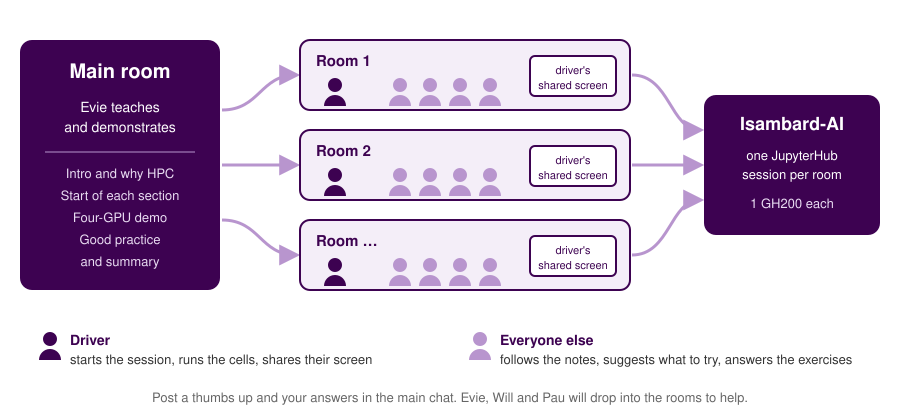
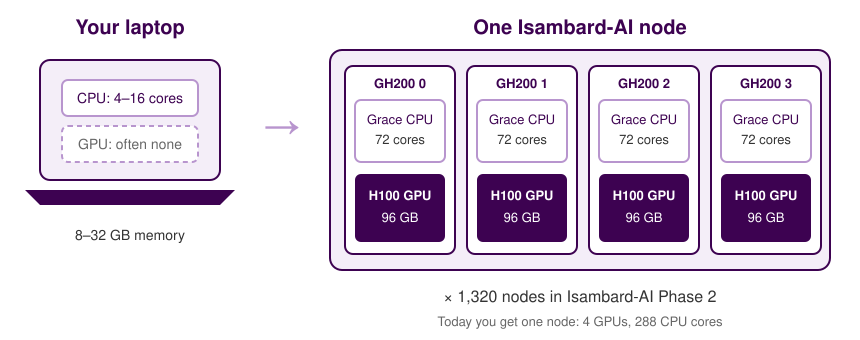
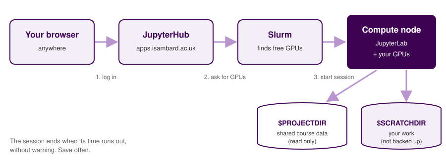
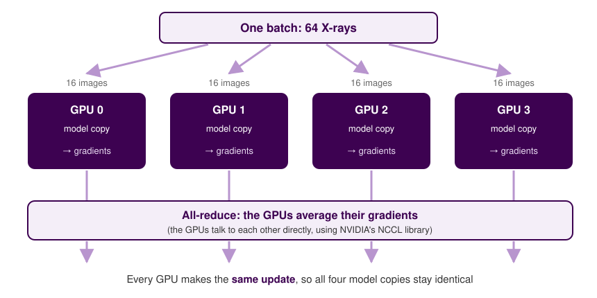

## Today's question {.center}

::: {.big .center}
4,083 X-rays and four GPUs.<br>Can we teach a computer<br>to spot a fracture?
:::

::: notes
By the end of the session, everyone will have trained an X-ray classifier on one GPU on Isambard-AI, seen a demo on four GPUs, and watched what the GPUs were doing.
:::

## How today works

- Each session has one GPU, and we'll demo four GPUs on screen
- You'll run a notebook that's already written: read each cell, then run it
- Training takes a few minutes each time, so watch the GPUs and ask questions
- Once a cell has run, try changing something
- The course notes go through every step, with an exercise for each section

## How the breakout rooms work

{fig-alt="Everyone starts in the main room, where Evie teaches and demonstrates. For the hands-on parts, people move into breakout rooms. In each room, one driver runs the notebook on Isambard-AI with one GPU and shares their screen, and the rest of the group follows the notes, suggests what to try and answers the exercises. Groups post a thumbs up and their answers in the main chat, and Evie, Will and Pau drop into the rooms to help." width="100%"}

::: notes
Say who the drivers are for each room. If a driver's session won't start, someone else in the group can start one instead. Remind drivers to keep their session running over the break.
:::

## The plan

::: {.flow}
[Why HPC?]{.step} [→]{.arrow} [Isambard-AI]{.step} [→]{.arrow} [The data]{.step}
:::

::: {.flow}
[1 GPU]{.step} [→]{.arrow} [4 GPUs]{.step} [→]{.arrow} [Good practice]{.step}
:::

<br>

::: {.muted .center}
We won't cover batch jobs (see *Introduction to HPC*) or training across several nodes
:::

# [01]{.section-number} Why HPC for AI? {background-color="#3d0251"}

[Why can't I just use my laptop?]{.section-question}

## Training is mostly multiplication

:::: {.columns}
::: {.column width="50%"}
To train a model, we show it thousands of examples many times over, adjusting millions of weights as we go.

Most of that work is multiplying large grids of numbers.
:::
::: {.column width="50%"}
::: {.cards}
::: {.card}
**CPU**
A few fast, flexible cores
:::
::: {.card}
**GPU**
Thousands of simpler cores, all doing the same sum at once
:::
:::
:::
::::

## When a laptop isn't enough

::: {.cards}
::: {.card}
**Time**
Each training run takes hours or days
:::
::: {.card}
**Memory**
"CUDA out of memory"
:::
::: {.card}
**Number of runs**
You want to try lots of settings or much more data
:::
:::

<br>

::: {.center}
Has anyone waited more than an hour for a model to train?
:::

::: notes
Ask the room, and let one or two people say what held them up.
:::

## Isambard-AI

{fig-alt="A typical laptop has 4 to 16 CPU cores and often no GPU. One Isambard-AI node has four GH200 superchips, each with a 72-core Grace CPU and an H100 GPU with 96 GB of memory. Isambard-AI Phase 2 has 1,320 nodes." width="100%"}

::: notes
Run by BriCS in Bristol as part of the UK's AI Research Resource.
:::

# [02]{.section-number} Getting onto Isambard-AI {background-color="#3d0251"}

[How do I get a GPU?]{.section-question}

## Asking for GPUs

{fig-alt="Your browser connects to JupyterHub, which asks the Slurm scheduler for GPUs. Slurm starts JupyterLab on a compute node with the GPUs you asked for, which reads the shared project folder and writes to your scratch folder." width="100%"}

## Start your session

:::: {.columns}
::: {.column width="50%"}
[apps.isambard.ac.uk/aip2-jupyter](https://apps.isambard.ac.uk/aip2-jupyter)

| Field | Choose |
|---|---|
| Project | *the course project* |
| Job duration | *until the end of the course* |
| Number of GH200s | 1 |
| Partition | *leave empty* |
| Reservation | `interactive` |
:::
::: {.column width="50%"}
::: {.bad}
When your time runs out, the session ends straight away, with no warning. Save regularly.
:::
:::
::::

::: notes
Share your screen and go slowly. This is where most problems happen: no UNIX username, not in the project, Partition filled in, or an old interactive job still running.
:::

## Set up the course kernel

In JupyterLab, go to **File → New → Terminal**

```{.bash filename="Terminal"}
$PROJECTDIR/hpc-ai-1/venv/bin/python \
    -m ipykernel install --user \
    --name hpc-ai-1 \
    --display-name "Python (HPC for AI part 1)"

cp $PROJECTDIR/hpc-ai-1/hpc-for-ai.ipynb ~/
```

<br>

Open `hpc-for-ai.ipynb` and check the kernel in the top right says "Python (HPC for AI part 1)"

## Check your GPUs

```{.python filename="hpc-for-ai.ipynb"}
print("Number of GPUs: ", torch.cuda.device_count())
```

<br>

::: {.cards}
::: {.card}
**`nvidia-smi`**
Run it in a terminal to see each GPU, its memory and what's running on it
:::
::: {.card}
**GPU dashboard**
Click the GPU icon in the left sidebar and open *Utilization* and *Memory*
:::
:::

## Your first GPU job

```{.python filename="hpc-for-ai.ipynb"}
a_gpu = a.to("cuda")         # copy to the GPU's memory
b_gpu = b.to("cuda")
a_gpu @ b_gpu                # warm-up
torch.cuda.synchronize()

start = time.perf_counter()
a_gpu @ b_gpu
torch.cuda.synchronize()     # wait for the GPU to finish
gpu_time = time.perf_counter() - start
```

::: {.muted}
Python doesn't wait for the GPU: it carries on as soon as it has sent the work. `synchronize()` waits until the GPU has finished.
:::

## Where things live

| | | |
|---|---|---|
| `$PROJECTDIR` | shared with the project | dataset, weights, kernel |
| `$SCRATCHDIR` | your working space | your data split and models |
| `$HOME` | limited to 100 GiB | your notebook |

<br>

::: {.bad}
None of these are backed up
:::

## Your turn ✍️ {background-color="#f4eef8"}

::: {.your-turn}
1. Run `nvidia-smi` in a terminal. How much memory does your GPU have?
2. Change `size` to `16384` in the matrix multiplication cell and run it again. How do the CPU and GPU times change?
:::

# [03]{.section-number} Meet FracAtlas {background-color="#3d0251"}

[What does our data look like?]{.section-question}

## FracAtlas

:::: {.columns}
::: {.column width="55%"}
- 4,083 X-rays of hands, legs, hips and shoulders
- From three hospitals in Bangladesh
- Labelled by two radiologists
- 719 show a fracture
- CC BY 4.0 licence
:::
::: {.column width="45%"}
::: {.big .center}
1 in 6
:::
::: {.center}
images show a fracture
:::
:::
::::

::: {.muted}
Abedeen *et al.* (2023) *Scientific Data* 10, 521
:::

## Splitting the data

::: {.flow}
[Training 70%]{.step} [Validation 15%]{.step .light} [Test 15%]{.step .light}
:::

```{.python filename="hpc-for-ai.ipynb"}
train_df, temp_df = train_test_split(
    df, test_size=0.3, stratify=df["fractured"], random_state=42
)
```

::: {.cards}
::: {.card}
**Training**
The model learns from these
:::
::: {.card}
**Validation**
Checked after each epoch
:::
::: {.card}
**Test**
Kept aside until the end
:::
:::

## Data leakage

:::: {.columns}
::: {.column width="55%"}
With medical images, all the images of one patient should go in the same set.

If they don't, the model can learn to recognise the patient instead of the fracture.
:::
::: {.column width="45%"}
::: {.bad}
FracAtlas has no patient IDs, and some body parts were X-rayed from more than one angle.
:::
::: {.good}
In your own work, split by patient.
:::
:::
::::

::: notes
Ask: if the same wrist was X-rayed from the front and the side, and one image is in the training set and the other in the test set, what could go wrong?
:::

## Arranging the images

```
fracatlas-split/
├── train/
│   ├── fractured/        → symbolic links to the shared images
│   └── not_fractured/
├── val/
└── test/
```

<br>

::: {.center}
The links point to the original images, so the split takes up almost no space
:::

## Your turn ✍️ {background-color="#f4eef8"}

::: {.your-turn}
Add a new cell to the notebook:

1. How many images show surgical hardware (the `hardware` column)?
2. What percentage of those show a fracture?
3. Why might hardware cause problems for a fracture classifier?
:::

# [04]{.section-number} Training on one GPU {background-color="#3d0251"}

[Can a computer learn to spot a fracture?]{.section-question}

## Transfer learning

We start with a model that has already been trained on over a million everyday photos, then fine-tune it on our X-rays

::: {.flow}
[ImageNet photos]{.step .light} [→]{.arrow} [YOLOv8n-cls]{.step} [→]{.arrow} [X-rays]{.step}
:::

<br>

::: {.cards}
::: {.card}
**Epochs**
How many times the model sees every image
:::
::: {.card}
**Image size**
512 × 512 pixels
:::
::: {.card}
**Batch**
Images per update
:::
::: {.card}
**Workers**
CPU processes loading images
:::
:::

## Training on one GPU

```{.python filename="hpc-for-ai.ipynb"}
model = YOLO(WEIGHTS)

model.train(
    data=str(SPLIT_DIR),
    epochs=EPOCHS,
    imgsz=IMG_SIZE,
    batch=BATCH,
    workers=WORKERS,
    device=0,             # one GPU
    project=str(RUNS_DIR),
    name="1gpu",
)
```

::: {.center}
Open the GPU dashboard before you run this cell
:::

::: notes
While it trains, ask whether GPU 0 is at 100%, and if not, what it might be waiting for. (Often the CPU workers loading images.) This leads into section 5.
:::

## Is the accuracy any good?

:::: {.columns}
::: {.column width="50%"}
::: {.big}
82%
:::
accuracy from always saying "not fractured", while missing every fracture
:::
::: {.column width="50%"}
| Score | For `fractured` |
|---|---|
| Precision | When it says "fractured", how often is it right? |
| Recall | What proportion of the real fractures did it find? |
:::
::::

<br>

::: {.good}
If we're deciding which X-rays to look at first, recall (sensitivity) matters most. Missing a fracture is worse than a false alarm.
:::

## Your turn ✍️ {background-color="#f4eef8"}

::: {.your-turn}
Look at your classification report and confusion matrix:

1. What is the recall for `fractured`? What does it mean in plain English?
2. How many of the real fractures did the model miss?
3. Would you use this model to decide which X-rays to look at first? What would you want to know before you did?
:::

# [05]{.section-number} Scaling to four GPUs (demo) {background-color="#3d0251"}

[Is more GPUs always faster?]{.section-question}

## Data parallelism

{fig-alt="A batch of 64 images is split into four slices of 16. Each GPU holds an identical copy of the model and works out its own gradients. The GPUs average their gradients in an all-reduce step, so every copy makes the same update." width="85%"}

## What's happening behind the scenes

:::: {.columns}
::: {.column width="50%"}
PyTorch's Distributed Data Parallel (DDP) runs a separate process for each GPU

Ultralytics writes a short training script and runs four copies of it with `torch.distributed.run`
:::
::: {.column width="50%"}
::: {.flow}
[notebook]{.step .light} [→]{.arrow} [rank 0]{.step}
:::
::: {.flow}
[rank 1]{.step} [rank 2]{.step} [rank 3]{.step}
:::
::: {.muted}
Look for the `DDP:` line in the output, and the four processes in `nvidia-smi`
:::
:::
::::

## Training on four GPUs

```{.python filename="hpc-for-ai.ipynb"}
model.train(
    ...
    batch=BATCH,          # 64 / 4 = 16 images per GPU
    device=[0, 1, 2, 3],  # four GPUs
    name="4gpu",
)
```

<br>

::: {.center}
Watch the dashboard: are all four GPUs working?
:::

## Why isn't it four times faster?

::: {.cards}
::: {.card}
**Starting up**
Launching four processes and connecting the GPUs
:::
::: {.card}
**Sharing gradients**
The GPUs have to stop and share after every batch
:::
::: {.card}
**Loading data**
The CPU has to keep four GPUs supplied instead of one
:::
:::

<br>

::: {.center}
With a small model and dataset, these costs cancel out much of the benefit.<br>With large models that take days to train, extra GPUs can make a big difference.
:::

## Your turn ✍️ {background-color="#f4eef8"}

::: {.your-turn}
Fill this in with the numbers from the demo

| Run | Minutes | Speed-up | Fractured recall |
|---|---|---|---|
| 1 GPU | | 1.0 | |
| 4 GPUs | | | |

What do you think would happen with a much bigger model?
:::

# [06]{.section-number} Good practice {background-color="#3d0251"}

[How do I use a shared supercomputer well?]{.section-question}

## Looking after your session and data

::: {.cards}
::: {.card}
**Save regularly**
Sessions end with no warning
:::
::: {.card}
**Check your time**
Run `squeue` in a terminal (the command is in the notes)
:::
::: {.card}
**Stop your server**
File → Hub Control Panel → Stop My Server
:::
::: {.card}
**Back up your work**
Nothing on Isambard-AI is backed up
:::
:::

## Using the GPUs well

::: {.good}
Check the dashboard. If your GPUs are often idle, more GPUs won't help.
:::

::: {.good}
Start small, with one GPU and a few epochs.
:::

::: {.good}
Only ask for what you need. If your job uses one GPU, ask for one GH200.
:::

## Next step: batch jobs

:::: {.columns}
::: {.column width="50%"}
### Notebooks
Good for exploring and learning

But they have a time limit and need your browser open
:::
::: {.column width="50%"}
### Scripts and batch jobs
Better for real training runs

They run on their own, and you can queue up lots at once
:::
::::

<br>

::: {.center}
See **[Introduction to HPC](https://bristol-training.github.io/intro-hpc/)**
:::

## Where to go next

- [Introduction to HPC](https://bristol-training.github.io/intro-hpc/): scripts, batch jobs and Slurm
- [Isambard-AI documentation](https://docs.isambard.ac.uk/)
- BriCS tutorial: [Distributed PyTorch Training](https://docs.isambard.ac.uk/user-documentation/tutorials/distributed-training/) across several nodes
- [Ultralytics image classification documentation](https://docs.ultralytics.com/tasks/classify/)
- [Applying for Isambard-AI access](https://docs.isambard.ac.uk/access/)

## Before you go {.center}

::: {.big .center}
Please stop your server
:::

::: {.center}
File → Hub Control Panel → **Stop My Server**
:::

::: notes
Check everyone has stopped their server, and share the feedback form link.
:::
